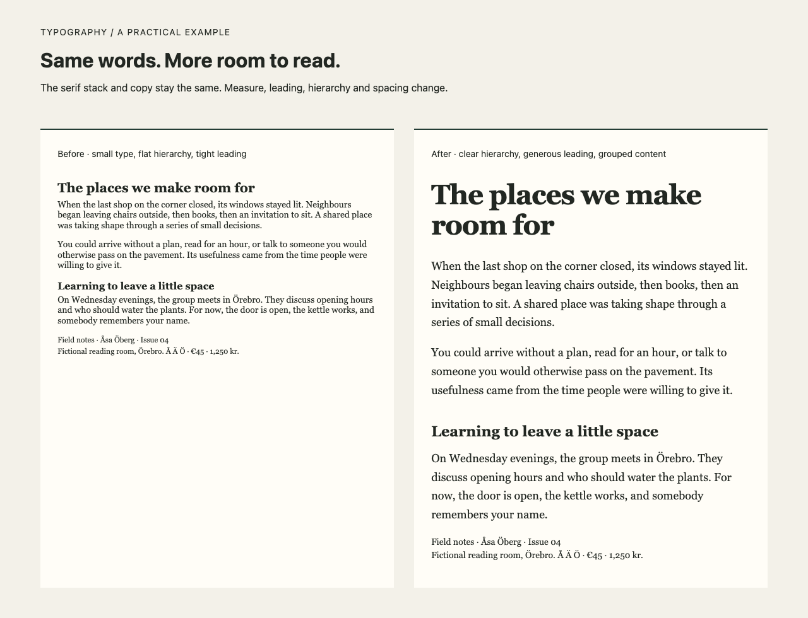

# Typography

Make reading feel considered, interfaces easier to scan, and display type more deliberate. Typography is an agent skill for choosing and refining type, hierarchy, spacing and grids while preserving an existing identity.

It starts with actual content and the reading task, then delivers a focused critique, implemented refinement or reusable system with concrete settings and honest verification. It works without Counterform, reference books or downloaded fonts.



[Open the before/after example](examples/before-after.html) · [Skill instructions](SKILL.md) · [Sources and attribution](references/sources.md) · [Agent contributor guide](AGENTS.md)

## Install

You need a file-capable agent that can read Markdown skills and their relative references. No API key, connector, account or paid service is required by this package; your agent host may have its own subscription or usage costs. Rendering requires a browser, and production font work requires fonts you have permission to use. PDF/document delivery requires suitable production tools in your host.

Start with a local checkout or extracted download of this repository named `typography`. Run the following from its root in a POSIX shell. Choose your host's documented skill directory; this package does not assume a discovery path or overwrite an existing installation.

```sh
set -eu
export TYPOGRAPHY_SKILLS_DIR='/your/chosen/skills-directory'
# Replace the example above with the directory documented by your agent host.
if [ -f SKILL.md ] && [ -f LICENSE ] && [ -f references/type-and-composition.md ]; then
  mkdir -p "$TYPOGRAPHY_SKILLS_DIR"
  if [ -e "$TYPOGRAPHY_SKILLS_DIR/typography" ]; then
    echo 'Typography already exists. Preserve it before updating.'
    exit 1
  else
    mkdir "$TYPOGRAPHY_SKILLS_DIR/typography"
    cp SKILL.md README.md AGENTS.md LICENSE "$TYPOGRAPHY_SKILLS_DIR/typography/"
    cp -R references agents examples "$TYPOGRAPHY_SKILLS_DIR/typography/"
    echo 'Copied typography. Reload your host and check its skill list.'
  fi
else
  echo 'Run this from the complete repository root containing SKILL.md, LICENSE and references/.'
  exit 1
fi
```

Confirm the destination contains `typography/SKILL.md` and `typography/references/`. For automatic activation, follow your host's own reload/discovery instructions and check that Typography is listed. The optional `agents/openai.yaml` supplies interface metadata for hosts that understand it. Automatic discovery across different hosts is not established by this package. If discovery is unavailable, explicitly ask your agent to read the installed `SKILL.md` and follow its relative references.

## Ask your agent

```text
Inspect this Typography repository and its README. Help me copy it into my
host's documented skills directory, preserving any existing installation.
Then read typography/SKILL.md and refine examples/editorial.html in my
chosen working folder. Keep the copy and font stack. Deliver the HTML,
exact typography settings, before/after reasons and checks actually run.
Use the public references only; do not install fonts or publish anything.
```

If already installed, say “Use Typography to refine this page, preserving its established typefaces,” and supply the page, its design authority and the desired output. In hosts supporting named skill syntax, `$typography` is also a useful explicit invocation.

## First result

Open [before-after.html](examples/before-after.html) directly in a browser. Both sides use identical fictional copy and the same serif stack; the change comes from measure, leading, hierarchy and spacing. No network access is needed. The deliberately weak before state is a teaching example, not recommended production styling.

[Example notes and briefs](examples/README.md) explain the settings and give three tasks: editorial reading, an existing-brand interface, and expressive display. Work on a copy outside the installed skill. A useful result includes implemented settings, reasons and an accurate account of rendering checks, not just a list of font names.

## Scope and verification

The skill gives design guidance, not a universal pairing score, a replacement for full product design, a font generator or an accessibility certification. Its numerical ranges are starting experiments. It preserves authorial copy and intentional brand choices.

System font stacks make the bundled specimens self-contained, but exact glyphs vary by platform. A real project must inspect its licensed assets, supported weights, axes, languages and fallback behavior. If an asset or renderer is missing, the agent should state what is missing, preserve the established choice and distinguish a proposal from a verified render.

Release checks use a fresh macOS restricted filesystem with synthetic fixtures, Markdown validation and Chromium rendering. They do not establish automatic discovery in every agent host, real browser zoom, print proof quality or full WCAG conformance. Read the example notes for the distinction between a root-font-size probe and browser zoom.

Counterform is an optional specimen/export companion when separately available. The skill and examples do not require it or another unpublished skill.

## Update, remove and contribute

To update, preserve local customizations, compare the new package, then replace only the reviewed installed files. To remove, remove only the installed `typography` folder after confirming the path. Your project outputs remain in your chosen working folder.

For a contribution, start with [AGENTS.md](AGENTS.md). Report issues with a small synthetic reproduction, browser/version and expected behavior. Do not include private project files, licensed font binaries or credentials. Support is best effort; there is no promised response time. If published on GitHub, use repository issues for ordinary bugs and private reporting for sensitive findings when the repository offers it.

The original skill and examples are covered by [LICENSE](LICENSE). The books, articles and standards in [sources](references/sources.md) retain their respective rights. No book pages, font files or third-party code are redistributed.
